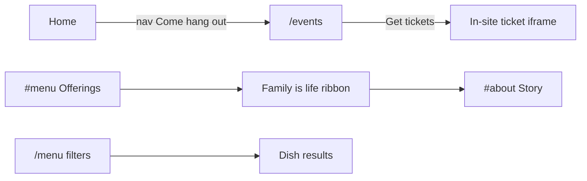

# Client review fixes (events, about, menu, catering, sauce images)

## Decisions locked

- Events leave the homepage entirely (no teaser); listing lives at `/events`.
- About (`StorySection`) remounts after [`OfferingsSection`](src/features/home/sections/OfferingsSection.tsx) (`#menu`), with a **Family is life** [`MovingRibbon`](src/components/media/MovingRibbon.tsx) between them (staff-editable `home_content.ribbon`).
- Staff can switch About media between **video or image** via `home_content` (gallery-style upload).
- Catering scroll + filter access fixes target `/menu` (not only `/catering`).
- Menu deep links use **semantic hashes** (`#catering`, `#pasta`, …), not `category-N`; offering cards let staff **pick a menu section** (or a custom URL).
- Sauce imagery: clear **`dish-40` (Sauces by The Pint)** photos from the menu list.



---

## 1. Dedicated `/events` page + navigation

**Add** [`src/routes/_site/events.tsx`](src/routes/_site/events.tsx) mirroring [`menu.tsx`](src/routes/_site/menu.tsx): prefetch `eventsQueryOptions`, `pageHead` with new `restaurantContent.metadata.events`, render a thin `EventsPage` that reuses [`EventsSection`](src/features/home/sections/EventsSection.tsx) / [`EventsList`](src/features/events/EventsList.tsx) (keep `id="events"` for any deep links).

**Home:** Remove `<EventsSection />` from [`HomePage.tsx`](src/features/home/HomePage.tsx).

**Nav:** In [`BottegaHeader.tsx`](src/components/BottegaHeader.tsx), change Come hang out from `to="/" hash="events"` → `to="/events"`.

**Stay on site:** In [`EventCard.tsx`](src/features/events/EventCard.tsx), remove the “Open tickets in a new tab” button (`target="_blank"`); keep the iframe dialog as the only guest ticket path. Drop unused `ticketsNewTab` copy if nothing else references it.

**Deep links / SEO:** Update newsletter fallback in [`event-newsletter.ts`](src/lib/events/event-newsletter.ts) from `/#events` → `/events`. Add `/events` to `INDEXABLE_PATHS` ([`sitemap.ts`](src/lib/seo/sitemap.ts) + test), Vite prerender pages, and metadata keys/tests.

---

## 2. About us: remount + Family is life ribbon + video or image (staff)

**Home composition** after offerings:

```tsx
<OfferingsSection />
{/* Family is life — home_content.ribbon + RibbonEditor when staff */}
<MovingRibbon text={data.ribbon} />
<StorySection />
```

Place the ribbon **between** offerings and story (not inside the offerings track). Reuse existing `home_content.ribbon` (default [`restaurantContent.home.familyIsLife`](src/content/en/restaurant.ts) = “Family is life”) and [`RibbonEditor`](src/features/home/admin/HomeContentEditors.tsx). [`OfferingsSection`](src/features/home/sections/OfferingsSection.tsx) already imports `MovingRibbon` / `RibbonEditor` but does not render them — move that chrome here (or into a thin wrapper around story) and drop the dead imports from offerings. Keep wrapper/z-index so the ribbon can overlap into `#about` per [`offerings.css`](src/features/home/sections/offerings.css) / [`menu-section.css`](src/features/home/sections/menu-section.css) bleed comments.

**Data:** Extend [`HomeContent`](src/lib/home/home-shared.ts) with a `story` key (merge over bundled defaults: current club video + poster). Shape:

- `mediaKind: 'video' | 'image'`
- `videoUrl`, `posterUrl` (video)
- `imageUrl`, `imageAlt` (image; alt required when image)
- Keep existing hardcoded English copy in the section for now (media-only staff edit matches the client ask)

**UI:** Refactor [`StorySection.tsx`](src/features/home/sections/StorySection.tsx) to read `homeContentQueryOptions`; render [`StoryVideo`](src/components/media/StoryVideo.tsx) for video, or an arch-framed `` (reuse `.arch-video` / `.bt-arch-frame`) for image—no CC/sound in image mode. Respect reduced motion.

**Staff:** Add `StoryEditor` in [`HomeContentEditors.tsx`](src/features/home/admin/HomeContentEditors.tsx) (kind radios + `FileUpload` `image/*,video/*` via `processMedia` / `uploadTileMedia('home-story', …)` like gallery [`TileEditor`](src/features/home/admin/TileEditor.tsx)). Wire floating edit control from `StorySection` when `useStaffSession().isAdmin`. Extend `mergeHomeContent` / validate + unit tests.

---

## 3. Semantic menu hashes + offering section picker

Today catering CTAs hardcode `/menu#category-8` ([`home-shared.ts`](src/lib/home/home-shared.ts), [`RequestPage.tsx`](src/features/requests/RequestPage.tsx) `CATERING_MENU_HASH`, CardEditor hint). DB section ids stay `category-N` for staff CRUD; **URLs become semantic**.

**Hash helpers** in [`filter-menu.ts`](src/lib/menu/filter-menu.ts) (extend existing tests that already expect `#catering`):

- `menuSectionSlug(name)` — dining: `"Pasta"` → `pasta`, `"Coffee & Tea"` → `coffee-tea`, etc.; strip parentheticals / “Catering · …” for subsection slugs if needed.
- `selectionForMenuHash`:
  - `#catering` → `'catering'` filter (group of all Catering sections) — first-class, not via `category-8`
  - `#pasta` / other dining slugs → that section’s **id** as selection (filter to that section; today non-catering hashes incorrectly fall through to `'all'`)
  - legacy `#category-N` still resolves for old bookmarks
- `scrollTargetForMenuHash(hash, sections)` → DOM `section.id` to scroll to (first catering section for `#catering`; matched section otherwise). Wire [`MenuPage`](src/features/menu/MenuPage.tsx) hash effect through this so `#catering` scrolls correctly without needing an element `id="catering"`.

**Defaults / call sites:** Change default catering offering card and `CATERING_MENU_HASH` (rename to something like `CATERING_MENU_HASH = 'catering'`) to `#catering`. Update scroll-to-section comments and CardEditor hints.

**Offering CardEditor** ([`HomeContentEditors.tsx`](src/features/home/admin/HomeContentEditors.tsx)): replace the free-text “Link destination” for typical menu CTAs with:

- Destination kind: **Menu section** | **Custom URL**
- Menu section: select **All dishes** (`/menu`), **Catering** (`/menu#catering`), or each non-catering section by display name (`/menu#pasta`, …) — options from live `menuQueryOptions` / bundled [`menu-data`](src/lib/menu-data.ts)
- Custom URL: keep today’s text field for `mailto:`, `https://`, `/order`, etc.
- Persist still as `linkHref` string (no schema change).

**Same-tab router for relative offering links** — today [`OfferingsCards.tsx`](src/features/home/sections/OfferingsCards.tsx) `OfferingLink` only uses `createLink` for `linkHref.startsWith('/menu')`; any other relative path (`/events`, `/order`, `/catering`, `/#locations`) falls through to `<Button href … target="_blank">`. Fix:

- In-site paths starting with `/` (including hash-only `#…` if ever used) → `OfferingButton` / TanStack `createLink` with `to` + optional `hash` (parse path and hash; no `target="_blank"`).
- `mailto:` / `tel:` → same-tab `<Button href>` (unchanged).
- `https://` only → `target="_blank"` + `rel="noopener noreferrer"`.

This matches the client “do not open new tabs unnecessarily” ask for offering CTAs, not just events tickets.

---

## 4. Catering visibility + menu filter access on small screens

Two related `/menu` bugs; fix together in [`MenuPage.tsx`](src/features/menu/MenuPage.tsx) + [`menu.css`](src/features/menu/menu.css).

**Catering / results scroll**

- Change `scrollToResults()` so it **always** scrolls `.menu-content` under the sticky header (today it only scrolls when `scrollY > top`, so Catering picks on a short phone leave trays below the fold).
- Raise `.menu-category-section { scroll-margin-top }` to clear the sticky header (align with [`scrollToSection`](src/lib/scroll-to-section.ts) / locations’ larger margin).
- Hash landing uses `scrollTargetForMenuHash` from §3 so `#catering` and section slugs scroll to the right block.

**Filter options unreachable**

Root causes: (1) portrait mobile wraps many pills then `scrollToResults` scrolls them away; (2) short/wide viewports (>900px landscape) keep `height: 100vh` sticky rail with no inner scroll while `main { overflow: clip }` clips lower categories including Catering.

Concrete CSS/behavior:

- **≤900px:** Keep filter sticky below `.shared-header-stack`; make `.menu-category-list` a single horizontal scroll row (`flex-wrap: nowrap; overflow-x: auto; scroll-padding-inline`) so All → … → Catering are always swipeable without a tall wrap stack.
- **Desktop / short height:** Replace fixed `height: 100vh` clip with `max-height: calc(100dvh - header)` + `overflow-y: auto` on the filter sticky/filter panel (`overscroll-behavior: contain`), and align `useMenuFilterRail` so a short viewport does not leave unreachable controls.
- Add/adjust Vitest coverage for filter-rail offset / scroll helper assumptions where practical.

---

## 5. Remove sauce imagery from the menu list

Target **`dish-40`** (“Sauces by The Pint”) — presentation `sauce-pints` in [`chownow-remaining-map.ts`](src/lib/menu/chownow-remaining-map.ts). [`DishImage`](src/features/menu/components/DishImage.tsx) already renders nothing when URLs are empty.

- Add a D1 data migration under `drizzle/d1/` that sets `image_url` and `image_variants` to `NULL` for `dish-40` (seed `0011_menu_images.sql` currently points every dish at `/media/menu-images/{id}/studio.jpg`).
- Remove or skip `dish-40` in `CHOWNOW_REMAINING_MAP` so polish/publish scripts do not regenerate sauce-pint shots.
- No need to delete R2 objects for the guest fix; orphaned media is fine.

---

## Out of scope (unless you expand later)

- Staff clear-photo control on every dish (not required once `dish-40` is nulled).
- Making About copy staff-editable.
- Changing Ticket Tailor newsletter emails that still deep-link to external `ticketUrl` when set.
