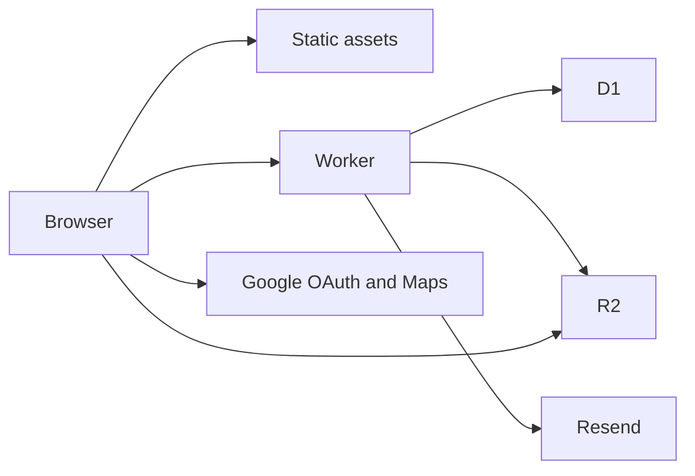

# Cloudflare-only rewrite

This is a separate plan from the Droplet migration. The site stays a TanStack Start app and keeps the design system where it is. Supabase, the Lovable auth package, Spaces, and the Marketplace Droplet are not part of this deploy. Wrangler is the only config. [wrangler.jsonc](wrangler.jsonc) gains a D1 database, an R2 bucket, a cron trigger, and the custom domain `bottega.boston`.

## Links

`bottega.boston` is the hostname on the Worker for now. In-site links stay relative (`/menu`, `/#locations`, `/events/request`) so a later move to the restaurant's main domain does not require a code change. External targets stay absolute: ordering, Instagram, Facebook, Ticket Tailor, and `mailto:`. Do not write `bottega.boston` or `lovable.app` into those hrefs.

Mail clients cannot use a relative href. [src/lib/email/blocks.ts](src/lib/email/blocks.ts), [src/lib/email/club.server.ts](src/lib/email/club.server.ts), and [src/lib/events/event-newsletter.ts](src/lib/events/event-newsletter.ts) keep a path (`/#locations`, `/email/bottega-wordmark.png`) and the send path prefixes the host of the request that is sending. When the Worker moves to another domain, the next email uses that host. Google’s OAuth redirect, the Turnstile widget, and the Maps key allow-list are the only places that name `bottega.boston`, and those are dashboard settings, not source.

Public routes already render in the browser and load their data after paint: [src/routes/_site/index.tsx](src/routes/_site/index.tsx) and [src/routes/_site/menu.tsx](src/routes/_site/menu.tsx) have no server loaders. Prerender those shells, plus catering, the event request page, and the unsubscribe page, as static assets. A static asset request does not spend Worker CPU. The Worker runs for reads and writes of D1, uploads, the request form, login, and the cron. Those handlers stay small so a request stays inside the free plan's 10 ms of CPU. Waiting on D1 or Resend does not count.

## Data

Port [drizzle/migrations](drizzle/migrations) `0000` through `0009` to SQLite. Drop the `auth` schema, the `storage` schema, row-level policies, and the triggers on `auth.users`. Keep the same tables: menu, gallery, home content, events, requests, subscribers, campaigns. Replace Postgres enums, `uuid`, `timestamptz`, and `text[]` with text and JSON. Staff rights become a `staff_allowlist` lookup in the Worker, which is what [src/hooks/useStaffSession.tsx](src/hooks/useStaffSession.tsx) uses `has_role` for today.

## Login

Remove `@lovable.dev/cloud-auth-js` and [src/integrations/lovable/index.ts](src/integrations/lovable/index.ts). [src/components/StaffAccess.tsx](src/components/StaffAccess.tsx) starts Google OAuth against a client you create. The redirect lands on a Worker route that checks the email against `staff_allowlist`, sets an HttpOnly session cookie, and sends the staff member back to the page they were on. Server functions in [src/lib/events/requests.functions.ts](src/lib/events/requests.functions.ts), the email functions, and the menu and gallery admin paths read that cookie instead of a Supabase JWT. [src/integrations/supabase/auth-middleware.ts](src/integrations/supabase/auth-middleware.ts) and [src/integrations/supabase/client.ts](src/integrations/supabase/client.ts) go away. Drizzle talks to the D1 binding.

## Files

[src/lib/menu/menu-api.ts](src/lib/menu/menu-api.ts), [src/lib/gallery/gallery-api.ts](src/lib/gallery/gallery-api.ts), and [src/features/emails/upload-email-photo.ts](src/features/emails/upload-email-photo.ts) stop calling `supabase.storage`. A server function checks the session and signs a PUT against the R2 S3 endpoint with the access key and secret. The browser still resizes the file, then uploads straight to that endpoint. The row stores the public R2 URL. The Worker holds `S3_ENDPOINT`, `S3_ACCESS_KEY_ID`, and `S3_SECRET_ACCESS_KEY`. The browser never sees the key or the secret. Bundled `/__l5e` media, such as [src/assets/hero.asset.json](src/assets/hero.asset.json), is uploaded once with those same credentials and the JSON `url` fields point at the public URL. Unsaved staff drafts stay in the browser's IndexedDB.

## Mail and the cron

[src/lib/email/resend.server.ts](src/lib/email/resend.server.ts) calls `https://api.resend.com` with `RESEND_API_KEY` only. The webhook in [src/routes/api/public/resend-webhook.ts](src/routes/api/public/resend-webhook.ts) stays, pointed at the Worker. The Wrangler cron trigger invokes the Worker on a schedule. That invocation is not an HTTP request, so it does not send a bearer token. The scheduled handler calls the same send function as [src/routes/api/public/send-scheduled.ts](src/routes/api/public/send-scheduled.ts). `CRON_SECRET` is a random value you create (`openssl rand -hex 32`) and store with `wrangler secret put`. It is not issued by Cloudflare or copied from `LOVABLE_CRON_SECRET`. [src/integrations/supabase/cron-auth.ts](src/integrations/supabase/cron-auth.ts) keeps checking it on the public HTTP route so a stranger cannot start a send.

Maps keep the library env name. The build sets `VITE_LOVABLE_CONNECTOR_GOOGLE_MAPS_BROWSER_KEY` from `GOOGLE_MAPS_BROWSER_KEY`. Turnstile stays as it is in [src/lib/events/requests.functions.ts](src/lib/events/requests.functions.ts). Add `bottega.boston` on the Turnstile widget and on the Maps key.

## Deploy

A push to `main` on this repo runs `.github/workflows/deploy.yml`. The workflow installs dependencies with Bun, runs `bun run build`, applies the D1 migrations to the remote database, and deploys with `cloudflare/wrangler-action`. The Vite build already turns on the Cloudflare plugin in [vite.config.ts](vite.config.ts), and [wrangler.jsonc](wrangler.jsonc) names the Worker entry. The action uploads the Worker, the prerendered pages, and the cron trigger together.

GitHub already holds `CLOUDFLARE_ACCOUNT_ID`, `CLOUDFLARE_API_TOKEN`, `CRON_SECRET`, `GOOGLE_MAPS_BROWSER_KEY`, `RESEND_API_KEY`, `S3_ACCESS_KEY_ID`, `S3_ENDPOINT`, and `S3_SECRET_ACCESS_KEY`. The action uses the Cloudflare account id and API token to deploy. It passes `GOOGLE_MAPS_BROWSER_KEY` into the Vite build. On each deploy it writes the rest onto the Worker with `wrangler secret bulk`, so the Worker env and GitHub stay the same set. The workflow file names those secrets and does not contain the values. It does not push to the Lovable remote.

Still missing from that GitHub list, and required before mail and login work: `RESEND_WEBHOOK_SECRET`, `TURNSTILE_SECRET_KEY`, `TURNSTILE_SITE_KEY`, and the Google OAuth client secret. Add them the same way when you have them.

## Cutover

Seed D1 from [drizzle/migrations/0001_seed_menu.sql](drizzle/migrations/0001_seed_menu.sql) rewritten for SQLite, plus the staff emails. Copy live public rows and objects out of Lovable later. Do not copy `auth.users`. The GitHub Action copies the secret list above onto the Worker at deploy time. Do not commit [.env](.env).

The free tier holds a restaurant site. The first bills are Resend past 100 emails a day, or the $5 Workers plan if a handler exceeds 10 ms of CPU.