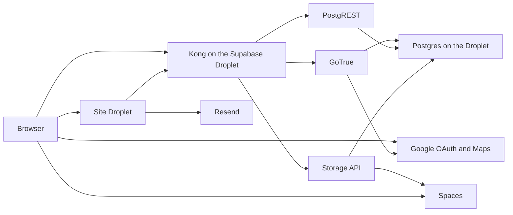

# Marketplace Supabase, site on its own Droplet

The free Supabase project pauses when it is quiet, so it is not the database. Use the [Marketplace Supabase 1-Click](https://marketplace.digitalocean.com/apps/supabase) (image slug `supabase`) and then turn off every container this site does not call. A 512 MiB Droplet cannot run that, and DigitalOcean does not sell 512 MiB with 2 vCPUs. The smallest 2 vCPU plan is `s-2vcpu-2gb` at $18, and the extra CPU does not help, because RAM is what runs out. The floor is `s-1vcpu-2gb`: **$12 a month**, 1 vCPU, 2 GiB RAM, 50 GiB disk. Files stay in Spaces at **$5**. Together that is about **$17**. Droplet backups add about 20% ($2.40). Postgres lives on that disk, so the backups are worth turning on.

The restaurant site leaves Cloudflare Workers. It runs as a Node process on a second Droplet, `s-1vcpu-1gb` (**$6 a month**). That box has no database and no uploads. Caddy is its only public listener and proxies to the Node server on localhost. A crontab on that Droplet posts to `/api/public/send-scheduled`. Do not put the site on the Supabase Droplet. That machine is already at its RAM floor. Do not use an App Platform worker. Stay on the `lovable` branch. Do not merge `origin/main`, and do not push to the `lovable` remote.

The Worker’s `SUPABASE_URL` is the Droplet hostname, for example `https://supabase.example.com`. Kong already serves `/auth/v1`, `/rest/v1`, and `/storage/v1` on that host. The public site stays on the Worker, on the apex domain. On first SSH login the image’s setup script asks for that hostname and an email and issues TLS. Wait about ten minutes after create, then stop the containers this site never calls: Studio, Realtime, imgproxy, Edge Functions, Logflare, Vector, the pooler, and postgres-meta. Leave Kong, GoTrue, PostgREST, Storage, and Postgres. Cap Postgres with a small `shared_buffers` (128 MiB) and a low `max_connections`. Schema changes go through `psql`, because Studio is off. The $4 Droplet is also the wrong disk: 10 GiB does not hold the image set.

Before the Worker is pointed at it, replace the default secrets in `/srv/supabase/supabase/docker/.env` (JWT secret, anon key, service role key, dashboard password). The cloud firewall allows 22, 80, and 443 only. Postgres is not public.

## Spaces

Set the Droplet Storage service to the S3 backend and give it the Spaces bucket, region, endpoint, and key. Staff uploads can keep the existing `supabase.storage` calls in [src/lib/menu/menu-api.ts](src/lib/menu/menu-api.ts), [src/lib/gallery/gallery-api.ts](src/lib/gallery/gallery-api.ts), and [src/features/emails/upload-email-photo.ts](src/features/emails/upload-email-photo.ts). The browser sends the bytes to Kong, and the Storage API writes them to Spaces. The Worker never stores them. Create the `menu-images` and `gallery-media` buckets after Storage is up. Unsaved staff drafts stay in the browser’s IndexedDB and still expire with the draft.

Bundled hero, story, and gallery files are `/__l5e/assets-v1/...` URLs, for example [src/assets/hero.asset.json](src/assets/hero.asset.json). Download them once from `https://bottega-delights-site.lovable.app`, put them in the same Spaces bucket, and point the asset JSON `url` fields at the CDN (`https://<bucket>.<region>.cdn.digitaloceanspaces.com/...`). Those images then load even if the Droplet is restarting. The Worker bundle is code only.

## Design system submodule

The library checked into this site at [src/design-system/bottega-f5161c](src/design-system/bottega-f5161c) matches [straiforos/bottega](https://github.com/straiforos/bottega) `src/bottega` (commit `e032bcb`), aside from tests that exist only upstream. Add that repo as a submodule at `vendor/bottega` and delete the copy. The submodule repo is its own TanStack app, so it stays outside `src/` and this site does not build or deploy it.

Keep the import path the site already uses. In [tsconfig.json](tsconfig.json), map `@/design-system/bottega-f5161c` to `vendor/bottega/src/index.ts` and `@/design-system/bottega-f5161c/*` to `vendor/bottega/src/*`. That covers the barrel, the `useSnackbar` imports from `@/design-system/bottega-f5161c/bottega`, and the wordmark in [src/features/emails/EmailEditorPage.tsx](src/features/emails/EmailEditorPage.tsx). Point the two `@import` lines in [src/styles.css](src/styles.css) at `vendor/bottega/src/bottega/styles/`. Do not edit files inside the submodule. The map component keeps reading `VITE_LOVABLE_CONNECTOR_GOOGLE_MAPS_BROWSER_KEY`; the Worker build sets that variable from `GOOGLE_MAPS_BROWSER_KEY`. Drop the Lovable library pin in [lovable.toml](lovable.toml) once the submodule is the source. Record the submodule SHA. Do not commit the design system's `.env`.

## What it costs

- Marketplace Droplet `s-1vcpu-2gb`, with the unused containers stopped: $12. 512 MiB OOMs. Two vCPUs at 2 GiB is $18 and does not buy more RAM.
- Spaces: $5, including the CDN and 250 GiB.
- Droplet backups, optional: about $2.40.
- Workers Free for the site. The limit that can force another $5 is **10 ms of CPU** per request. Waiting on the Droplet, Spaces, or Resend does not count. If rendering exceeds that, Workers Paid is the next step.
- Resend Free: 3,000 emails a month and 100 a day. A Pasta Club send past 100 people in one day needs the $20 plan.
- Turnstile is free. Add the Worker hostname on the widget.
- Maps: add the Worker origin to the browser key’s HTTP referrers. `GOOGLE_MAPS_API_KEY` is unused.
- A domain you already own can sit on Cloudflare at no extra charge. Point only the Supabase hostname at the Droplet.

## Code changes

- Google staff sign-in goes through `@lovable.dev/cloud-auth-js` in [src/integrations/lovable/index.ts](src/integrations/lovable/index.ts). Create a Google OAuth client whose redirect is `https://<supabase-host>/auth/v1/callback`, and set GoTrue’s Google provider in the Droplet `.env`. [src/components/StaffAccess.tsx](src/components/StaffAccess.tsx) should call `supabase.auth.signInWithOAuth({ provider: 'google', options: { redirectTo } })`. `redirectTo` is the Worker origin. Add that origin to GoTrue’s site URL and extra redirect list. The allowlist trigger in [drizzle/migrations/0002_restrict_signup_and_storage.sql](drizzle/migrations/0002_restrict_signup_and_storage.sql) stays.
- Resend is proxied through `https://connector-gateway.lovable.dev/resend` using `LOVABLE_API_KEY` in [src/lib/email/resend.server.ts](src/lib/email/resend.server.ts). Call `https://api.resend.com` with `RESEND_API_KEY` only. Keep Svix verification in [src/routes/api/public/resend-webhook.ts](src/routes/api/public/resend-webhook.ts).
- [src/integrations/supabase/cron-auth.ts](src/integrations/supabase/cron-auth.ts) trusts `LOVABLE_CRON_SECRET`. Generate a new `CRON_SECRET` and add a cron trigger in [wrangler.jsonc](wrangler.jsonc) for `POST /api/public/send-scheduled`. Do not copy `LOVABLE_API_KEY`.
- Replace the hardcoded `https://bottega-delights-site.lovable.app` links in [src/lib/email/blocks.ts](src/lib/email/blocks.ts), [src/lib/email/club.server.ts](src/lib/email/club.server.ts), and [src/lib/events/event-newsletter.ts](src/lib/events/event-newsletter.ts) with the request origin or `SITE_URL`.

## Database

The 1-Click already creates `auth.users`, the API roles, and the storage schema. Do not run [db-init/init-db.sql](db-init/init-db.sql). After the stack is healthy, apply [drizzle/migrations](drizzle/migrations) `0000` through `0009` with `psql` on the Droplet, then insert the staff allowlist emails. Worker secrets are the Kong URL, the anon key, and the service role key from the Droplet `.env`, plus Resend, Turnstile, the cron secret, and the Maps browser key. Do not commit [.env](.env) or the Droplet env file.

## Cutover

First boot uses the Drizzle seed ([drizzle/migrations/0001_seed_menu.sql](drizzle/migrations/0001_seed_menu.sql)) and the bundled media copied into Spaces. Live menu edits, gallery rows, subscribers, and campaigns stay on Lovable until a separate copy of the `public` tables. Copy storage objects into Spaces. Do not copy `auth.users`. Check home, map, menu, a staff photo upload, staff Google login, a catering request, one email, and the Resend webhook before moving the public domain.
